# SehatFirstPro redesign brief

## User request

> We NEED TO REDEISGN THIS sehatfristpro site,
>
> EVERYTHING, font, colors, style etc\
> Search online for ANTI AI PROMPT, AI SLOP, Common AI patters and fonts to note them to not use
>
> Search online awwward winign wesbite pattersn
>
> Text patterns (no too much bottom explaining text, No micro headings, No pill shape text, No over explaining etc)
>
> Spacing (not  tooo much)
>
> react scrollign elements and components
>
> framer compoennts etc
>
> NO SHARP EDGES (seaerch APPLE DEISGN, DEISGN MD
>
> FIRST BAINSTROEM, FIND, NOTE THINGS
>
> DO things in D:\SITES\PORTFOLIO\sehatpro folder locally first dont push it run code so i can view
>
> ALL PAGES, each page (dont mess with connections of plans page)
>
> But redeisgne ach and evvery page, every section
>
> Awward level deisgn, Awward wining wesbite
>
> NOTE: KEEP THE CURSUR EFFECT
>
> 2. WE need images, illustratiosn like thes (images) through out the site, Not randomly placed, but intentioanly that help in describing the thing on screen
>
> NOt just one image or two, but through out in all pages So make sheets of multiple images illustratsion ike these)
>
> First analzye these (imaeg 1,2) it has two type of images
>
> HOw they are blending with bg, and second solid
>
> analzye make a base json prompt to lock the deisgn
>
> Check awward wininng website how they use images, of diffrent sizes and localtions
>
> [kiza-charles-ux-animation] use this for animations, scrolling aniamtiosn inetratison etc
>
> Also animations such as appearisng , gsap text aniamitiosn etc
>
> NOTE: NOTE ALL THIS DOWN IN A DOCS and reread it NOTE ALL OF IT AS IT IS,with images, and reread)
>
> Add a crititque agent that points out mistakes, layout errors, responsiveness and mobile expirreice, improvement
>
> from header to footer, all pages, evverything redeisgn
>
> Continuee loop, fix it, correct it, check other sites, match it, find elements we can add, react components multiple csrolling
>
> NOTE: Dont mess with /plans page backend connection, and login button redirects
>
> NOTE EVEYRHTING DOWN, then START BRANINSTROMING, CHECKING , finding, noting, repeating etc etc
>
> no want current images and illustrations
>
> for icons we can use this [https://skills.klvn.dev/fun-isometric](https://skills.klvn.dev/fun-isometric) (as currently doing as well)
>
> Make sure to note things / skills I said to use as well in docs direclty in summary and reread the docs again again for context

Attachments are visual references. The Root UI Kit and other screenshot captions identify third-party examples. The screenshots supply visual characteristics for original work.

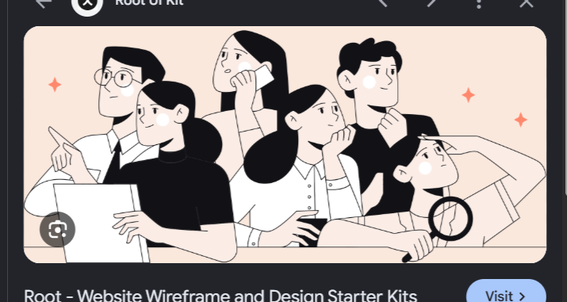

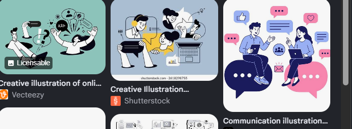

## Working summary

Redesign the maintained React/Vite public proposal end to end. Use the supplied [kiza-charles-ux-animation skill](file:///C:/Users/Krishna/.codex/skills/kiza-charles-ux-animation/SKILL.md), including its recipes and techniques, for scroll, menus, controls and the existing custom cursor. Use original image sheets and press-style drawings with occasional [fun-isometric](https://skills.klvn.dev/fun-isometric) icons. Research award-winning sites, anti-AI design prompts, type and copy patterns, Apple layout and shapes, DESIGN.md, Framer Motion and GSAP. Run a separate critique and browser verification loop. Run the React proposal and local checkout destination locally. Keep the existing plans data, purchase handoff and set of login destinations as implemented. Keep the original terms, privacy, shipping and cancellation content. Local work only.

## Illustration correction

> they are not illsutratison line illustratisno like this
>
> same face, same style

The new references repeat the same two images. Match the face construction across the cast and use fine line illustration, solid black hair silhouettes, small black brows and eyes, simple noses, white cheek dots and opaque cream clothing or skin areas. Recurring characters have the same hair silhouettes and features in each scene. Art uses flat fills and clean alpha for the blended scenes. Earlier heavy contours and print texture were rejected.

## Solid background correction

> also NOTE ALL images of these has solid bg (so they can be used in our bg)
>
> also make sure ot generaete more as needed in site
>
> CONTINUEE
>
> CONTINUEEE

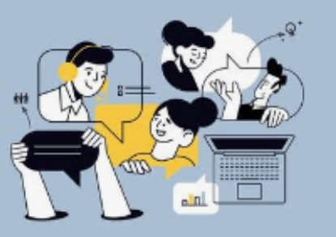

All published illustration assets use opaque backgrounds. The integrated home illustration uses the surrounding panel’s exact peach. The catalogue tiles use their own solid fields. The transparent hero master remains available for exporting the same artwork with a different matched field. Add original scenes when a page needs a subject that the existing sheets do not cover.

## Homepage revision

> nahhhh wait
>
> redeisgn again the home page full
>
> the color, the layout everything
>
> 1. Also we need to add these two hospitals as well in home page Medicare Hospital M.G.Tower, Kolar road Bhopal,Care and Cure Hospital, Mandideep
>
> [kiza-awwards]
>
> [kiza-charles-hero]
>
> REDEISGN AGAIN and give me such image to preview as you did (like image 1)
>
> [https://aarogyaopd.com/](https://aarogyaopd.com/) , [https://swasthopd.com/](https://swasthopd.com/)(check this, visually as well)(copy there code and use from these as well)
>
> hero, about us, patners, Why choose, care services, customers etc
>
> these are also some great examples
>
> Also I told you to explore online and use interatvie awward wining scrolling components, and cards etc
>
> the color, the theme, font, style again REDEISGN
>
> Add critique agent, check other sites,,
>
> WE need to add scrollign and hover interactions as well

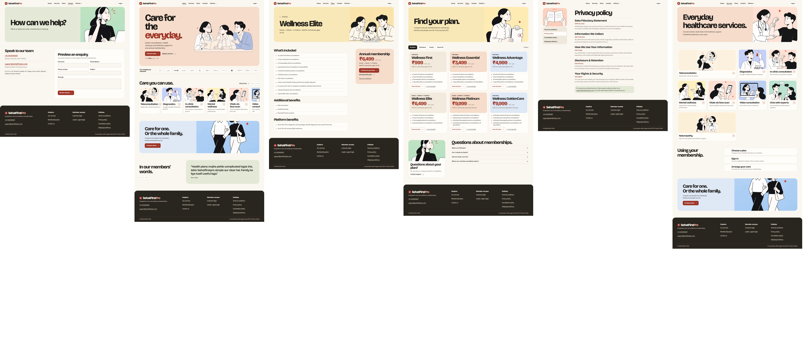

The first attachment shows the rejected homepage and the requested format for a new screenshot board. The other two attachments are the hospital logos for the new partner section. Scope for this revision is the whole homepage, including its header and footer styling. Preserve the existing account and purchase destinations. Continue to use the earlier thin-line drawing style and solid backgrounds.

The homepage revision follows the supplied [kiza-awwards](file:///C:/Users/Krishna/.codex/skills/kiza-awwards/SKILL.md) for art direction and jury review, [kiza-charles-hero](file:///C:/Users/Krishna/.codex/skills/kiza-charles-hero/SKILL.md) for the poster study, and [kiza-charles-ux-animation](file:///C:/Users/Krishna/.codex/skills/kiza-charles-ux-animation/SKILL.md) for motion and interaction. The final board captures the working React homepage at desktop and phone widths.

## Clinical redesign correction

> Nahh
>
> this should not be hero section....
>
> I told you to rediegsn check HOw other sites using,
>
> The bg color white,
>
> This is medical doctor site
>
> Use logo as we currnelty have (ceheck logo form folder)
>
> REDEISGNN FULLY, REDEISGNN ,
>
> THE COLORS, BG, HERO SECTION,
>
> FONT
>
> (CHEck the sites I gave, https://aarogyaopd.com/ , https://swasthopd.com/   Use , cehck USE IMAGES IN HERO SCTION
>
> (NOTE THIS LADY WITH PHONE)
>
> GENERATE MORE, YEAS<
>
> this deosnt feel medical doctor site
>
> this was original https://www.sehatfirstpro.com/ sehatfrrispro
>
> and our look shit
>
> EVERYTHING, font, colors, style etc
> Search online for ANTI AI PROMPT, AI SLOP, Common AI patters and fonts to note them to not use
>
> Search online awwward winign wesbite pattersn
>
> Text patterns (no too much bottom explaining text, No micro headings, No pill shape text, No over explaining etc)
>
> Spacing (not  tooo much)
>
> react scrollign elements and components
>
> framer compoennts etc
>
> NO SHARP EDGES (seaerch APPLE DEISGN, DEISGN MD
>
> FIRST BAINSTROEM, FIND, NOTE THINGS
>
> DO things in D:\SITES\PORTFOLIO\sehatpro folder locally first dont push it run code so i can view
>
> ALL PAGES, each page (dont mess with connections of plans page)
>
> But redeisgne ach and eveyr page, every section
>
> Awward level deisgn, Awward wining wesbite
>
> NOTE: KEEP THE CURSUR EFFECT
>
> 2. WE need images, illustratiosn like thes (images) through out the site, Not randomly placed, but intentioanly that help in describing the thing on screen
>
> NOt just one image or two, but through out in all pages So make sheets of multiple images illustratsion ike these)
>
> First analzye these (imaeg 1,2) it has two type of images
>
> HOw they are blending with bg, and second solid
>
> analzye make a base json prompt to lock the deisgn
>
> Check awward wininng website how they use images, of diffrent sizes and localtions
>
> kiza-charles-ux-animation use this for animations, scrolling aniamtiosn inetratison etc
>
> Also animations such as appearisng , gsap text aniamitiosn etc
>
> NOTE: NOTE ALL THIS DOWN IN A DOCS and reread it NOTE ALL OF IT AS IT IS,with images, and reread)
>
> Add a crititque agent that points out mistakes, layout errors, responsiveness and mobile expirreice, improvement
>
> from header to footer, all pages, evverything redeisgn
>
> Continuee loop, fix it, correct it, check other sites, match it, find elements we can add, react components multiple csrolling
>
> NOTE: Dont mess with /plans page backend connection, and login button redirects
>
> NOTE EVEYRHTING DOWN, then START BRANINSTROMING, CHECKING , finding, noting, repeating etc etc
>
> no want current images and illustrations
>
> for icons we can use this https://skills.klvn.dev/fun-isometric (as currently doing as well)
>
> 1. Curernt deisgn has problem TOO much compacted, No appropriate spacing, The icosn and boxes aer like before AI like (not awward winnig like)
>
> the texts are just TOOO BIG with curernt font (dont like the font (imaeg 2)
>
> the content is OK JUST REDEiSGN
>
> (the bg color (note exact white but soft white)
>
> The footer fixx as well cehck awward wiingn footers
>
> USE LOGO wihhc we have assets/images/sehatlogo.png

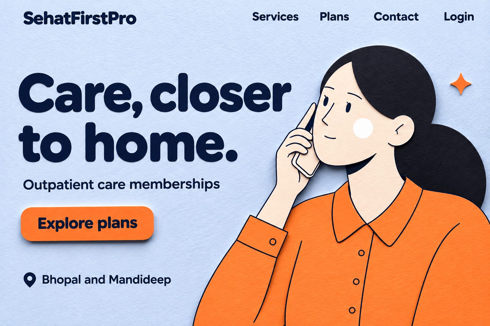
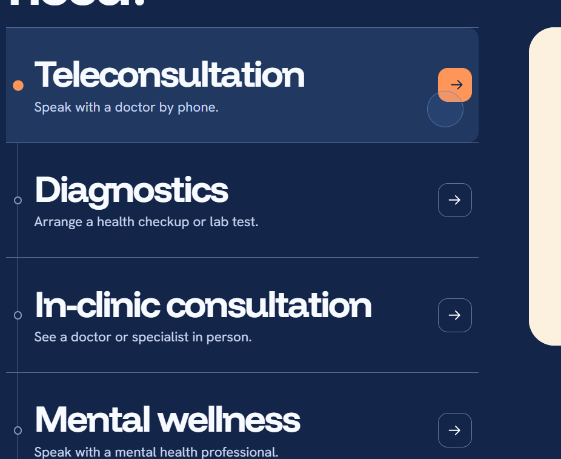

Both latest attachments are examples of what to change. The original thin-line illustration references above establish the secondary artwork style, with opaque matched fields or discrete pastel fields. Use an original clinical photograph in the hero and new original artwork throughout. Use the original SehatFirstPro logo asset. Keep the existing public content, named hospital partners, plan data and checkout endpoint, login targets, contact behavior and cursor effect.

## Layout correction

> what I am saying is this STYLE is wrong
> The boxes, layouts etc
>
> it still feels like HOw we have sehatfirstpro at first
>
> NOT AWWARD WINNNIG STYLE
>
> [kiza-awwards]
> the buttons, the layout, the cards everything

The attachment is the layout the user rejected. Keep the earlier soft-white brief, doctor-led imagery and original supplied logo. Recompose the pages, navigation, controls and section structures. Apply the kiza-awwards reference on visual composition and use an independent visual critique.

## Homepage-first color and composition correction

The request continues the full redesign with the homepage implemented and reviewed first. The attached image shows the rejected soft-white and blue composition. White remains the main reading surface. Use visibly different colors for functional sections and let the composition, buttons, cards, photography and scrolling feel equally distinct. Keep the original logo, partner listings, clinical subject, cursor and integration paths.

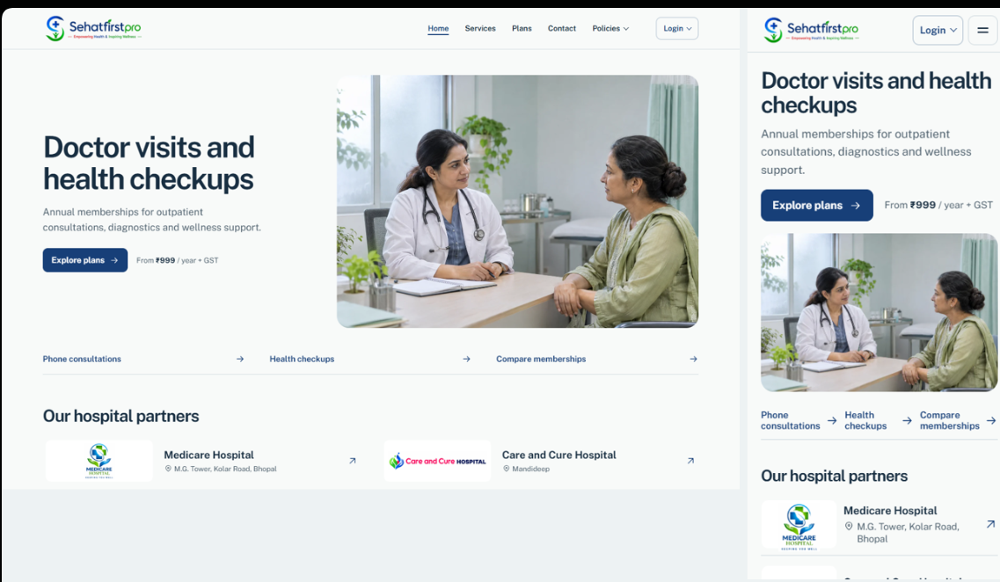

## OPD reference blend

The user asks to draw the homepage’s palette, sections, hero and UI direction from sehatfirstpro.com, aarogyaopd.com and swasthopd.com. The screenshot identifies the prior oversized serif partner directory and muted colors as rejected. Build an original SehatFirstPro composition with the reference palette and functional patterns. Retain the supplied hospital marks, locations, logo and existing paths.

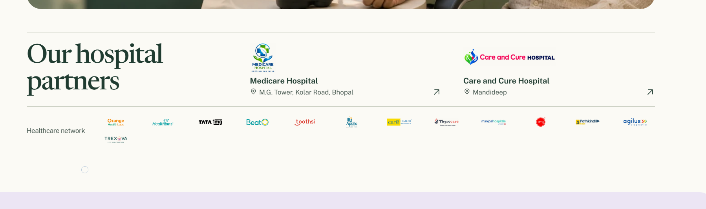

The active homepage direction uses a navy photographic lead, white content background, a blue primary action, restrained pastel illustrations and compact provider listings. Urbanist is self-hosted with its OFL license. Header and footer use the provided original logo. Existing public content is the source for services and membership limits. Use stacked illustrations to explain the three booking steps.

## Local full-site continuation — 18 November 2026

> Color of images and sections ar ltitel dull, make them correct
> And now make other pages in our curernt style as well
> (local dont push it) QUCKLY
> DONT PUSH IT

The latest screenshot points to the blue and mint membership step panels and their illustrations. Increase the color clarity of the illustration artwork and the blue, mint and peach section fields. Extend the current Urbanist, navy, white and blue homepage system to services, all eight service details, plans, all six plan details, contact and four policies. Keep the original logo, cursor, benefits, legal text, checkout destination and login destinations. Use the already-applied kiza-awwards and kiza-charles-ux-animation guidelines. This iteration is local only. Do not commit, push or deploy it.

## Phone-first correction — local only

> Focus on the phone view,
> sehatfirstpro.com In phone looks way better then ours
> FOCSU ON phone view home page first then others
> (dont jsut reduce size, but the layout, the arrnageemnt can be cahneg accorading to phone for ebttter accesability, the hamburger menu etc)
> DOO IT
>
> ours look cheap very cheap
> DEEPLY analzye change, redeisgn if needed in mobile, (complete redeisgn section can also allowed) corrcet in mobile

The current local screenshot is a rejected design reference, not instructions embedded in an image. Analyze the live production phone layout against the local version. Prioritize the phone homepage, then other phone routes. A complete section recomposition is authorized. Keep the no-push constraint. The local revision uses a photograph-first white hero, full-width primary touch action, three compact service shortcuts, a real modal mobile menu, a two-column illustrated service directory, short horizontal booking steps, Public Sans phone body text and Urbanist headings. The DOM order matches the visual reading order. Existing plan and login destinations are retained. An independent mobile critique checked 320, 390 and 430px, menu focus/escape and the other main routes. No commit, push or deployment is authorized for this iteration.

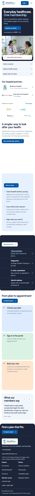

## Publishing authorization

The user's latest instruction supersedes the local-only restriction for this completed revision: 'quickly correct it doo it and push'. Commit and push the corrected mobile homepage and matching public-page design to the existing GitHub repository. Keep backend destinations unchanged.

## Final scope correction — homepage only

> nahh why did you cahneg other pages ??
> services, plans, contact, policies etc
> other pages, make them back as beforeonly hoome page change

Restore the exact previous production application and stylesheet on every non-home route, including service details and plan details. Keep the corrected mobile homepage and its desktop presentation. The entry point selects the homepage app only for `/` and selects the preserved `src/production` app for all other paths. Remove the newly introduced non-home page renderer and policy wrapper, and restore the previous policy source files. This correction supersedes the full-site style rollout. Push the correction to the same GitHub branch as the prior requested push.

## Homepage service and benefit sections correction

> In sehatfirspro
> it has so much better
> and ours (imeg 4 , 5very bad)
> Correct the home page, redeisgn
> these (image 4,5)

The first three attached images are production visual references for medical photo cards, the member testimonial and the mobile drawer. Images four and five identify the two rejected homepage sections: the navy sticky illustration/service list and the pale blue three-line benefits block. Replace those two sections. Keep every non-home route on the preserved original production application.

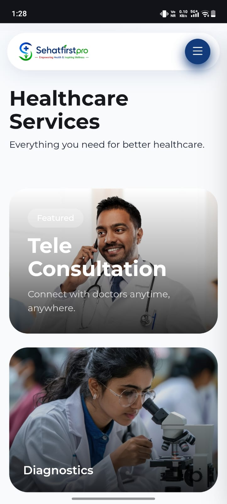
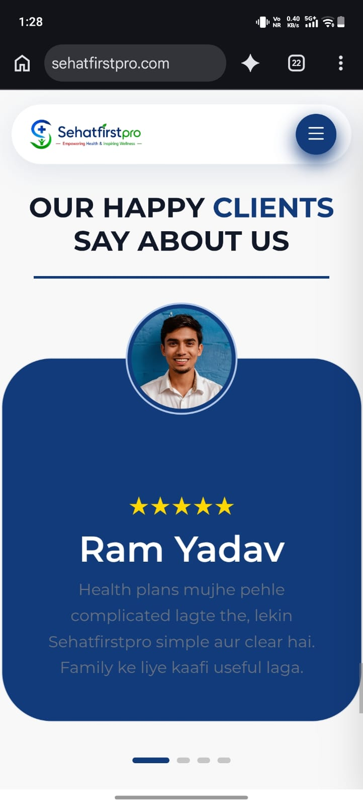
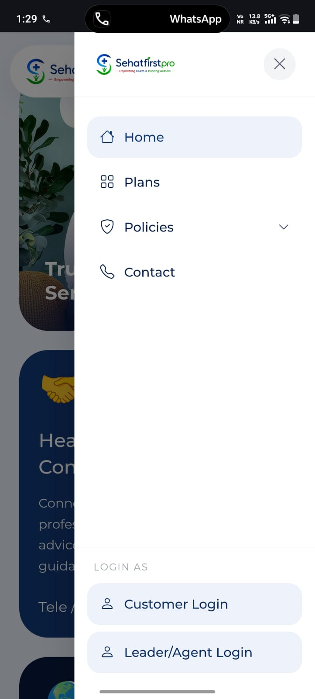
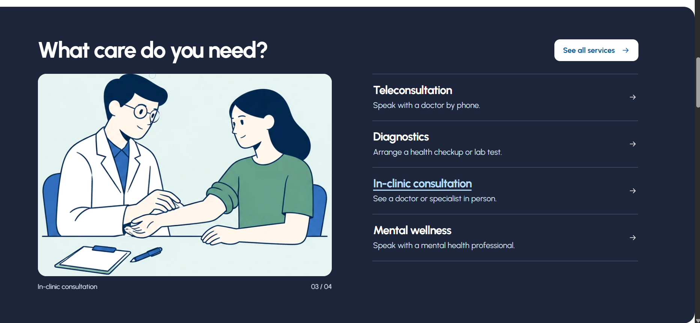
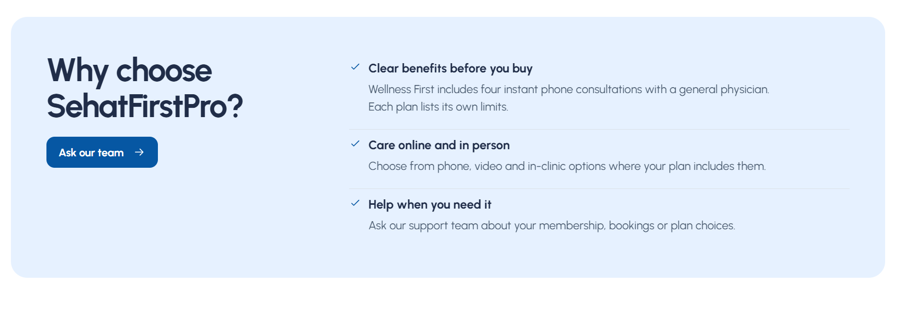

Implementation: eight photographic service cards using the supplied site's original photography, with a mosaic on desktop and full-width cards on phones. White text has a strong lower gradient and each entire card links to its original service detail. The reasons section uses four individual benefit cards, restrained colored icons, and a doctor portrait with a contact link. Responsive WebP exports of the existing photos are in public/medical; all 18 variants together are under 0.8 MB. Prices and availability copy follow the current membership data. No other pages, redirects or backend connections change.

## Membership section unslop correction

> this looks ai,
> I want yiu to analzye anti ai prompt
> [kiza-charles-unslop] [kiza-unslop]
> Fix this section
> redeisgn again and push

The attached crop identifies the four matching pastel-icon benefit tiles as rejected. Apply both explicitly requested skills from C:/Users/Krishna/.codex/skills. The anti-AI audit, product direction, implementation prompt, passes and verification are recorded in UNSLOP.md. Replace only this homepage section with factual catalog-derived Wellness First allowances. Keep the rest of the homepage and every original non-home page unchanged. Push the corrected section.

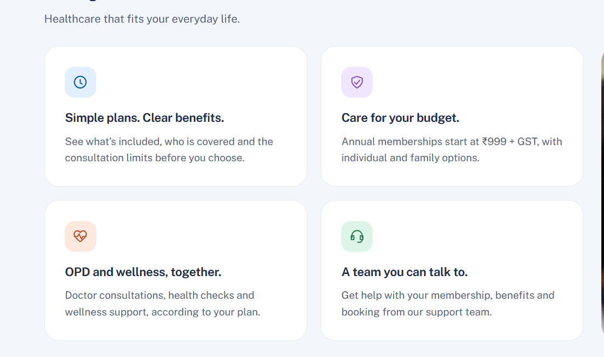

## Apply the unslop audit to the hero

> in our hero section as well

The three follow-up screenshots identify the existing phone hero, its pastel icon shortcuts and the floating label on the medical photo. Extend the current kiza-charles-unslop and kiza-unslop work to the hero. Remove those decorative layers, keep the clinical photograph and original logo, simplify the copy and type, and use one plan action plus one service text link. The phone composition places the offer before the photo. The scope remains homepage only, and the earlier request to push still applies.

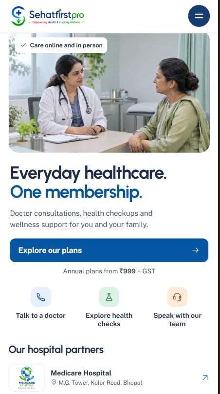
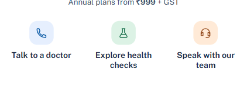
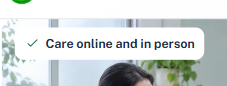
