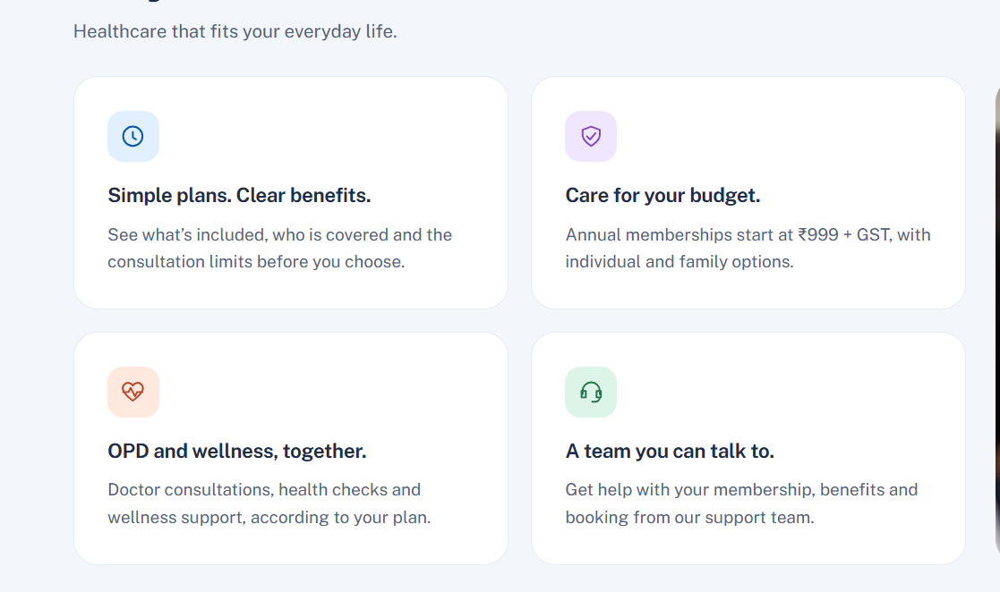

# Homepage membership section audit

Scope: replace the rejected four-card “Why choose” section, then extend the same audit to the hero after the user's follow-up. All other homepage sections, section order, public routes, plan data and portal destinations stay unchanged. The user explicitly requested a redesign and push, so implementation proceeds without a direction approval pause.

## Skills used

- `C:/Users/Krishna/.codex/skills/kiza-charles-unslop/SKILL.md`
- `C:/Users/Krishna/.codex/skills/kiza-unslop/SKILL.md`

Both skills' signs and token references were read. The visual and effects references were consulted before deciding that this section needs no additional image or image treatment. This audit applies the unslop workflow created by Damir Sokolovsky ([@heydamir](https://x.com/heydamir)), CC BY 4.0, and the Charles adaptation incorporating Emil Kowalski and Charles Liu. The summary below is specific to SehatFirstPro.

## Audit

| Where | Tell | Decision |
| --- | --- | --- |
| `.home-reason-grid` | Four equal panels repeat exactly the same icon, title and paragraph pattern | Delete the grid and wrappers |
| `.home-reason-icon` variants | Blue, purple, orange and green have no semantic meaning | Remove all four icon tiles |
| Benefit titles | Generic claims and charming short sentences could be pasted into another product | Replace claims with the actual Wellness First allowances |
| Heading subtitle | “Healthcare that fits your everyday life” adds no decision-making information | Delete |
| `.home-reason dt` | Small text uses negative tracking and heavy emphasis | Use ordinary 16px body text and 400/500 weights |
| Card spacing | 13px gaps, 21px padding and 26px gutters do not form a consistent rhythm | Use 4px increments |
| Card surfaces | Every fact receives a border, white raised surface and large radius | Show facts in a semantic benefits table with only useful row rules |
| Doctor portrait | Another stock photograph decorates a section that needs plan clarity | Remove from this section |
| Floating contact control | The contact link becomes another layer over the portrait | Move the real phone number into a plain support line |

## Direction

Product: SehatFirstPro provides annual outpatient and wellness memberships for individuals and families.

Character: factual, calm, legible.

World: the consultation desk and the membership benefits sheet that someone reads before joining.

Moment: the actual ₹999 Wellness First price and its annual consultation allowances, taken from the same catalog used for plan details.

Signature: benefit names and their annual quantities share a clear reading line; quantities are right-aligned tabular figures.

Concept: let someone inspect what the entry membership includes before opening its full details.

The concept survives the next state: the primary link opens the existing Wellness First detail route. Support remains a direct phone link. It rules out decorative icons, anonymous medical imagery, equal feature tiles, invented proof and filler copy.

## Five moment options considered

1. Behaviour: a plan selector could reveal allowance changes, but would duplicate the existing Plans page and add work to this explanatory section.
2. Real content: show the catalog's actual allowance list. Chosen because it proves what the membership provides.
3. Proportion: give the allowance table more width than the short plan introduction. Used to support the selected content.
4. Type: use the real entry price in the heading. Its size carries a buying fact rather than decoration.
5. Object or image: the doctor portrait cannot demonstrate plan limits. Removed instead of generating another scene.

## Implementation prompt

Redesign only SehatFirstPro's rejected homepage reasons section as a readable membership benefits sheet. Keep its position and every other section. Use Wellness First from the existing plans JSON as the sole source of price, eligibility and allowances. State that the price excludes GST. Show every listed core benefit in a semantic table with aligned annual counts. Keep one primary link to the original plan-detail URL and one direct support phone link. Preserve the site's blue accent and Public Sans. Use 400/500 weights, 16px readable body text, a 4px spacing rhythm, open white space and a narrow phone layout without horizontal scrolling. Remove decorative icons, pastel tiles, generic benefits copy, extra photography, badges, shadows and entrance motion. Do not invent testimonials, savings, features, availability or data. Do not modify backend or login destinations.

## Passes applied

1. Spacing: 12/16/20/24/32/48/64px steps; table cells align; phone text remains 16px.
2. Color: white surface, one ink ramp and the existing blue for the plan and phone links.
3. Icons: remove all decorative icons; only the existing directional link arrow remains.
4. Copy: replace the four marketing claims with the actual plan price, eligibility, family-plan availability and eight benefits. Labels have no trailing periods.
5. Type: keep Public Sans, 400/500 weights and tabular quantities; remove negative tracking from small text.
6. Layout: asymmetric plan introduction and wider benefits table on desktop; normal reading order on phones.
7. Details: no card wrappers or shadows; table rules help track benefits to counts; the primary action retains visible focus and an 8px radius.
8. Moment: real catalog information is the visual. No image prompt or new image was needed.
9. Motion: the section is static. No heading reveal, parallax, looping icon or card animation remains.

## Verification

Checked at 320, 390, 768, 1440 and 1920px. All eight displayed quantities match the catalog, the original plan-detail and phone URLs remain, and no horizontal overflow or browser errors appeared. WCAG A/AA axe checks on the section passed at 390 and 1440px. Build and all 22 route-render checks passed.

A separate visual reviewer confirmed that the repeated feature-card pattern is gone and both layouts read clearly. Its two copy corrections were applied: singular “Dental checkup and consultation” for quantity 1, and “Benefit” as the table heading. The open area beside the longer table stays empty rather than receiving filler decoration.

Before/after screenshots and the browser report are in `D:/Temp/sehat-unslop/`.

## Hero continuation

The user's follow-up says “in our hero section as well” and singles out the pastel shortcut tiles and the floating “Care online and in person” label.

Audit: the floating label restates the service offer; the three tinted icon shortcuts repeat navigation; two-tone heavy display copy emphasizes a generic slogan; stacked supporting metadata competes with the main action. The clinical photo itself is relevant and stays.

Product: annual outpatient and wellness memberships for individuals and families.

Character: calm, direct, legible.

World: the same clinical consultation and membership information as the benefits sheet.

Moment: the existing photograph of a doctor speaking with a patient.

Signature: the actual starting price sits with one plan action; service discovery remains a secondary text link.

Concept: explain the annual membership and let someone open plans before the medical photograph supplies the human context.

Implementation prompt extension: remove the floating image badge and the three decorative icon tiles. Use a literal annual outpatient-care headline, Public Sans 500, one ink color and the brand blue only on the primary action. Keep the real starting price and a secondary service link. On phones put the headline, explanation and actions before the photograph. Keep the supplied logo, cursor, photo, hospital partners, menu and login destinations. Do not add new illustration, badges, decorative material or entrance motion.

The desktop hero is an open white split, with its copy centered against the clinical photograph. The phone composition reads title → offer → price → actions → photograph. Touch targets are at least 44px. The photograph has no overlay label. All eight services are still directly reachable in the unchanged service directory, and Contact remains in navigation and the support line. No feature is removed.

Hero verification: checked 320, 390, 768, 1440 and 1920px. No horizontal overflow, missing hero image or browser errors. The old photo badge and shortcut tiles are absent. Primary and secondary actions keep their original plan/service destinations; the primary target is 48px high, and the medical photo starts within the phone's first viewport. Mobile menu open/Escape and the existing customer login URL were verified. Hero WCAG A/AA axe scans passed at 390 and 1440px. Final build and all 22 route-render checks passed. The preserved production entry path, app and styles were not edited.

## Member stories — requested production change

The user requested the same unslop treatment for the member testimonial section and explicitly asked for this section to be pushed. Remove the pale enclosing panel, oversized heavy heading and circular button chrome. Keep the source quotes and names word-for-word, show their existing portraits, and use a legible Public Sans quotation with plain Previous/Next controls and a quiet position count. No stars, verification labels or new claims are added. The quote is not auto-advanced or animated. Content determines the section height, including on phones.

The “From plan to appointment” section must remain unchanged in this commit. Its requested redesign is a separate local preview to be made only after the testimonial commit has been pushed.

Checked all four quotes and portrait loads, Previous/Next wraparound, 320/390/768/1440px overflow, section accessibility at 390/1440px, build and all 22 route renders. The existing Journey function is compared with HEAD before pushing to confirm it has not changed.
